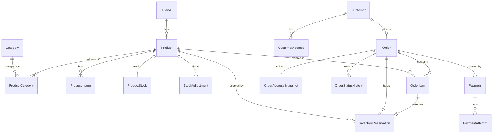

# Phase 5 — Database Schema & Entity Relationships

Schema source: [`prisma/schema.prisma`](../prisma/schema.prisma)  
Initial migration: [`prisma/migrations/0001_init/migration.sql`](../prisma/migrations/0001_init/migration.sql)

## ER Diagram

## Key Schema Decisions
- **Immutable Order Snapshots**: `OrderItem` stores `skuSnapshot`, `productNameSnapshot`, `brandNameSnapshot`, `dialAndStrapSnapshot`, `unitMrpPaise`, `unitPricePaise`, `unitDiscountPaise`, `gstRateBps`, `lineTotalPaise`, and `lineGstPaise`. `OrderAddressSnapshot` stores the delivery address at checkout time.
- **Database Idempotency**: `Order.idempotencyKey` has a `@unique` constraint, preventing duplicate orders under retries or concurrent submissions.
- **Guest & Future Auth**: `Customer.authUserId` is nullable and `@unique`, ready to link with Auth.js in a later phase without schema breaking changes.
- **Foreign Key Integrity**: `OrderItem.productId` and `InventoryReservation.productId` use `onDelete: Restrict` so historical orders cannot lose product references; child snapshots (`OrderItem`, `OrderAddressSnapshot`, `OrderStatusHistory`, `Payment`) cascade on `Order` deletion.
